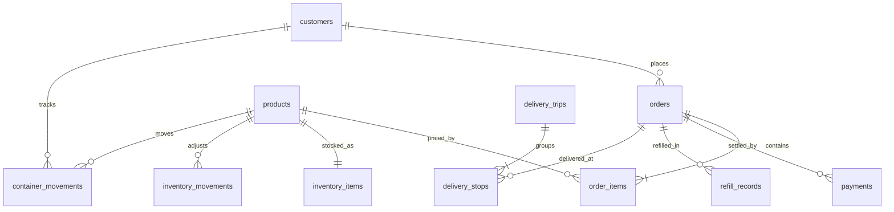

# AquaBest Data Model & ERD

Schema file: `server/db/migrations/001_initial.sql` (SQLite, `PRAGMA foreign_keys = ON`).

## Tables
1. `customers` (`id`, `name`, `contact_number`, `address`, `is_demo`, `created_at`, `updated_at`)
2. `employees` (`id`, `name`, `role` in `super_admin|manager|staff`, `active`, `is_demo`, `created_at`, `updated_at`)
3. `products` (`id`, `name`, `container_type`, `size_label`, `price_cents`, `active`)
4. `orders` (`id`, `order_number` UNIQUE, `customer_id`, `customer_name`, `source`, `service`, `status`, `payment_status`, `payment_method`, `subtotal_cents`, `delivery_fee_cents`, `discount_cents`, `total_cents`, `notes`, `assigned_employee`, `business_date`, `created_at`, `updated_at`, `completed_at`)
5. `order_items` (`id`, `order_id`, `product_id`, `quantity`, `unit_price_cents`, `line_total_cents`, `ownership`, `arrangement`)
6. `payments` (`id`, `order_id`, `method`, `amount_cents`, `status`, `reference`, `recorded_at`, `verified_at`)
7. `expenses` (`id`, `category`, `description`, `amount_cents`, `payment_status`, `payment_method`, `reference`, `business_date`, `active`, `created_at`, `updated_at`)
8. `inventory_items` (`product_id`, `available_full_qty`, `available_empty_qty`, `minimum_threshold`, `updated_at`)
9. `inventory_movements` (`id`, `product_id`, `movement_type`, `quantity`, `reason`, `order_id`, `refill_id`, `created_at`)
10. `refill_records` (`id`, `order_id`, `product_id`, `completed_quantity`, `assigned_employee`, `completed_at`)
11. `container_movements` (`id`, `customer_id`, `customer_name`, `order_id`, `product_id`, `quantity`, `movement_type`, `related_movement_id`, `recorded_at`)
12. `delivery_trips` (`id`, `assigned_employee`, `trip_status`, `started_at`, `completed_at`, `remittance_status`)
13. `delivery_stops` (`id`, `trip_id`, `order_id`, `delivery_status`, `actual_cash_received_cents`, `completed_at`, `issue_reason`)
14. `audit_logs` (`id`, `entity_type`, `entity_id`, `action`, `before_data`, `after_data`, `created_at`)
